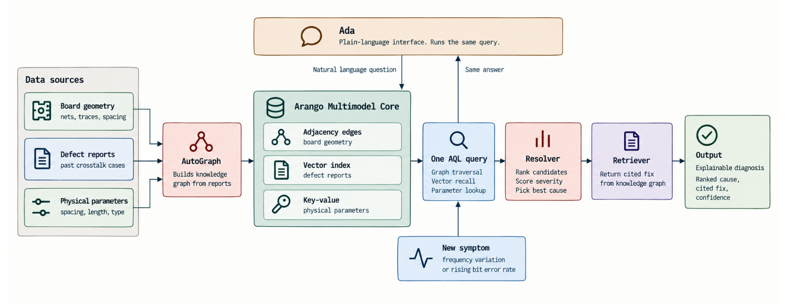
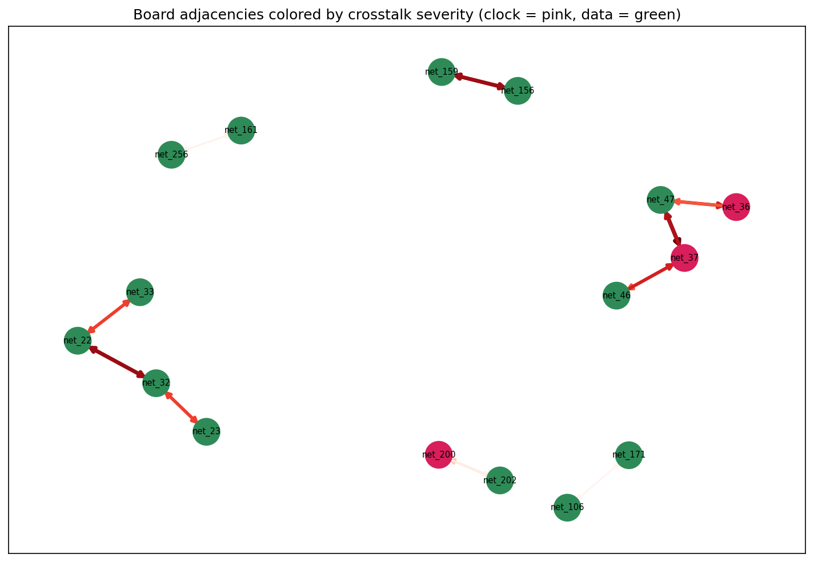
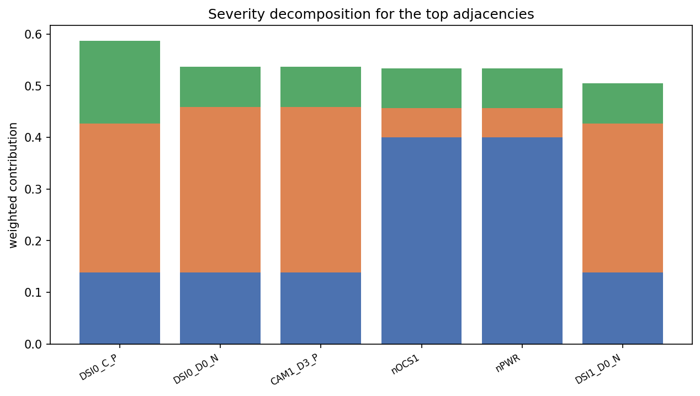
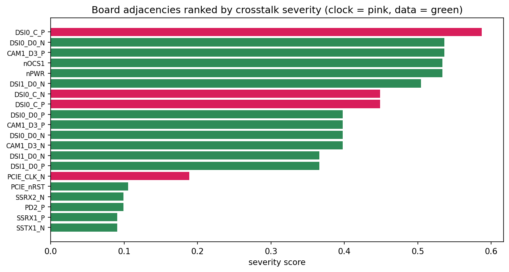
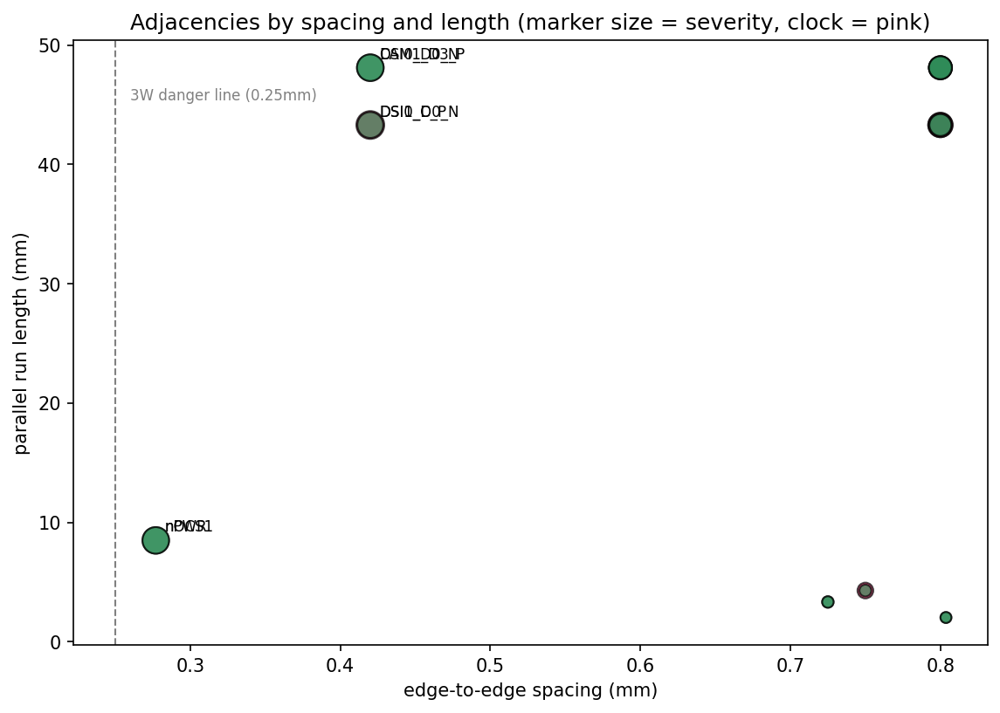

# Explainable Crosstalk Diagnosis on Arango

> A signal-integrity agent that finds the physical adjacency behind a board defect, ranks it,
> and cites how it was fixed before — as one query over one multimodel store.

<p align="center">
  <em>A board defect is not a value in one table. It is a relationship between two nets.</em>
</p>

When a data lane shows frequency variation and a rising bit error rate, every trace passes its
own design-rule check and the board still fails. The fault is not in any single net. It is a
**power or clock line running too close to a data line**, over a long enough parallel run to
couple noise into it. That proximity is an **edge, not a row**, which is exactly why
record-by-record inspection misses it.

This build models the board as a graph, gives that graph a memory of past defects, and resolves
both in a single [AQL](https://docs.arango.ai/arangodb/stable/aql/) query on the
[Arango Contextual Data Platform](https://arango.ai/products/contextual-data-platform).

---

## Architecture



One store holds three data shapes, and one query path turns a symptom into an explainable,
cited cause:

- **Design graph** — the KiCad board parsed into nets (nodes) and adjacency edges carrying
  spacing, parallel length, layer, and trace width.
- **Vector store** — past defect reports embedded for similarity recall via `APPROX_NEAR_COSINE`.
- **Knowledge graph** — built by [AutoGraph](https://docs.arango.ai/agentic-ai-suite/autograph/)
  from the same corpus, cited through the
  [GraphRAG Retriever](https://docs.arango.ai/agentic-ai-suite/graphrag/).

The agent recalls similar defects, traverses to the physical neighbors, **scores** each
candidate, **judges** which one explains the symptom, and returns a **cited fix**. The graph
proves the geometry; the agent interprets the cause.

---

## The hero fault

Point the engine at a real Raspberry Pi CM4 IO board with `python src/agent.py auto`. It scans
every adjacency, scores each one, and diagnoses the worst — no victim is hardcoded:

```
=== VICTIM ===
DSI1_D0_N (net_47)  symptom: frequency variation and rising bit error rate

=== CANDIDATES (ranked, proved) ===
  DSI0_C_P   sev 0.5873  [leading]    clock   gap 0.42mm  len 43.3mm  B.Cu
  DSI0_C_N   sev 0.4487  [unlikely]   clock   gap 0.80mm  len 43.3mm  B.Cu

=== RECALLED CASES ===
  Frequency variation traced to an impedance mismatch      <- same symptom, wrong cause
  Camera lane jitter from an adjacent high-speed signal
  Clock-to-data coupling over a long adjacent run

=== JUDGE (interpretation, a hypothesis) ===
  chosen: DSI0_C_P
  judge confidence: medium  ->  finding tier [corroborated]
  reasoning: DSI0_C_P runs on the same outer copper for 43.3 mm at 0.42 mm, a clock
  whose fast edges couple into a neighbouring data lane, matching the symptom.

=== CITED FIX (retriever) ===
  Increase local spacing; add a grounded guard trace with stitching vias; or reroute
  the aggressor to an inner layer. [cites the clock-coupling reports]

=== CORROBORATION ===
  mechanism converged : True
  verdict             : AGREE - graph and citation point at the same story
```

A DSI clock lane running 43 mm alongside a data lane from a *different* camera interface, 0.42 mm
apart on the bottom layer. The top vector match ("impedance mismatch") is the **wrong** cause,
sharing the symptom but not the geometry — and the graph corrects it.



---

## Why this architecture

The finding rests on **two independent surfaces agreeing**. The graph-and-judge chose the clock
coupling from geometry and reasoning. The Retriever, reading only the chosen cause, cited past
reports about the same mechanism from the knowledge graph. Neither was told the other's answer,
and they converged.

That convergence is the payoff of one multimodel store. A split stack — a graph database beside
a vector database — runs two queries, holds partial results in application code, and rebuilds the
join that finds the fault on every request. A vector-only tool has no topology to traverse and
cannot tell a real adjacency from a look-alike report. Two different shapes of the same store,
reaching the same mechanism independently, is the confidence a fragmented stack has no way to
reach.



The severity score weighs spacing and parallel length equally, because crosstalk accumulates
along a coupled run. The hero scores **high on length and loudness, low on spacing** — the exact
profile a proximity-only check misses.

---

## Quickstart

```bash
# clone and enter
git clone <your-repo-url> crosstalk-agent
cd crosstalk-agent

# virtual environment
python -m venv venv
source venv/bin/activate            # Windows: venv\Scripts\activate

# dependencies
pip install -r requirements.txt

# credentials
cp .env.example .env                # then edit with your details
```

```
# .env
ARANGO_HOST=https://<your-deployment>.arangodb.cloud
ARANGO_DB=crosstalk_v1
ARANGO_USER=root
ARANGO_PASSWORD=<your-password>
OPENAI_API_KEY=<your-key>
RETRIEVER_ID=                       # set after deploying the Retriever
RETRIEVER_BASE=
```

Build the data and run the diagnosis:

```bash
python src/prepare_autograph.py     # 1. write the synthetic defect corpus (30 reports)
python src/ingest.py                # 2. parse the board, load graph + vectors + index
python src/agent.py auto            # 3. scan the board, diagnose the worst adjacency
python src/agent.py auto --deep     # 3b. same, with Deep Search for a fuller cited playbook
```

**Step 2** reports `{'nets': 73, 'adjacencies': 10, 'defect_reports': 30, 'dimension': 1536}`.
Of 75 candidate net pairs, 65 are intended routing (differential pairs and same-interface buses)
and are skipped; the 10 that remain are the real cross-interface adjacencies.

To enable cited fixes, upload `data/autograph/*.md` to **AutoGraph Studio** in the Arango web
interface, build the graph with `text-embedding-3-small`, deploy the Retriever, and set
`RETRIEVER_ID` / `RETRIEVER_BASE`. Without it, the agent falls back to a local corpus citation
and the rest of the pipeline runs unchanged.

---

## The notebook

`crosstalk_analysis.ipynb` runs the whole pipeline end to end, cell by cell, from a fresh
database to the final figures. It closes with five visuals, all saved to `assets/`:

| figure | what it shows |
|---|---|
|  | every real adjacency, colored by class, sized by severity |
|  | the ten adjacencies ranked; the hero clears the field |
|  | spacing / length / loudness per candidate |
|  | spacing vs parallel length, with the 3W danger line |
|  | recall ranks close matches above near-misses and filler |

---

## Repository layout

```
src/
  config.py             every knob: net classes, the 3W rule, severity weights, tiers
  parse_board.py        KiCad board -> nets and adjacency edges (skips intended routing)
  ingest.py             load the graph, embed the corpus, build the vector index
  prepare_autograph.py  generate the synthetic defect corpus for AutoGraph
  agent.py              the resolver: recall, traverse, score, judge, cite, corroborate
  agent_graph.py        the same investigation, driven by a LangGraph ReAct agent
data/
  CM4IOUSB3.kicad_pcb   the board
  autograph/            the generated corpus (markdown + manifest.json)
assets/                 architecture diagram + figures saved by the notebook
crosstalk_analysis.ipynb
```

Every knob the engine turns lives in `config.py`. Swap your own process design kit's spacing
rule into the 3W threshold, point the parser at your board, and the ranking retunes with no
edit to any query.

---

## Two agents, one engine

The resolver in `agent.py` decides the step order itself. `agent_graph.py` hands the same three
tools — `traverse_and_score`, `recall_similar`, `cite_fix` — to a LangGraph ReAct agent that
chooses the order. Same tools, same database, same answer: the engine is the data and the query,
not the orchestration around it.

---

## Honest edges

The engine only catches faults that can be modeled as a relationship between nets; a defect that
is not an adjacency is invisible to it. The adjacency edges depend on a proximity threshold
someone chose. The top cause is a lead, not a verdict, capped at `corroborated` until confirmed
on silicon. The board is real geometry; the defect corpus is synthetic and labeled as such, so
the build demonstrates the method rather than real hardware history.

The same traversal extends to impedance mismatch, return-path discontinuity, and power-integrity
issues, because each is a relationship in the same graph. Run it earlier and it becomes a
design-rule check: the parser reads a layout in progress and flags an adjacency the day it is
routed, before any board is fabricated.